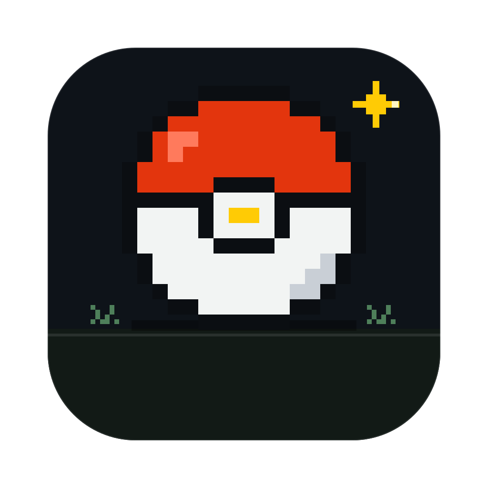
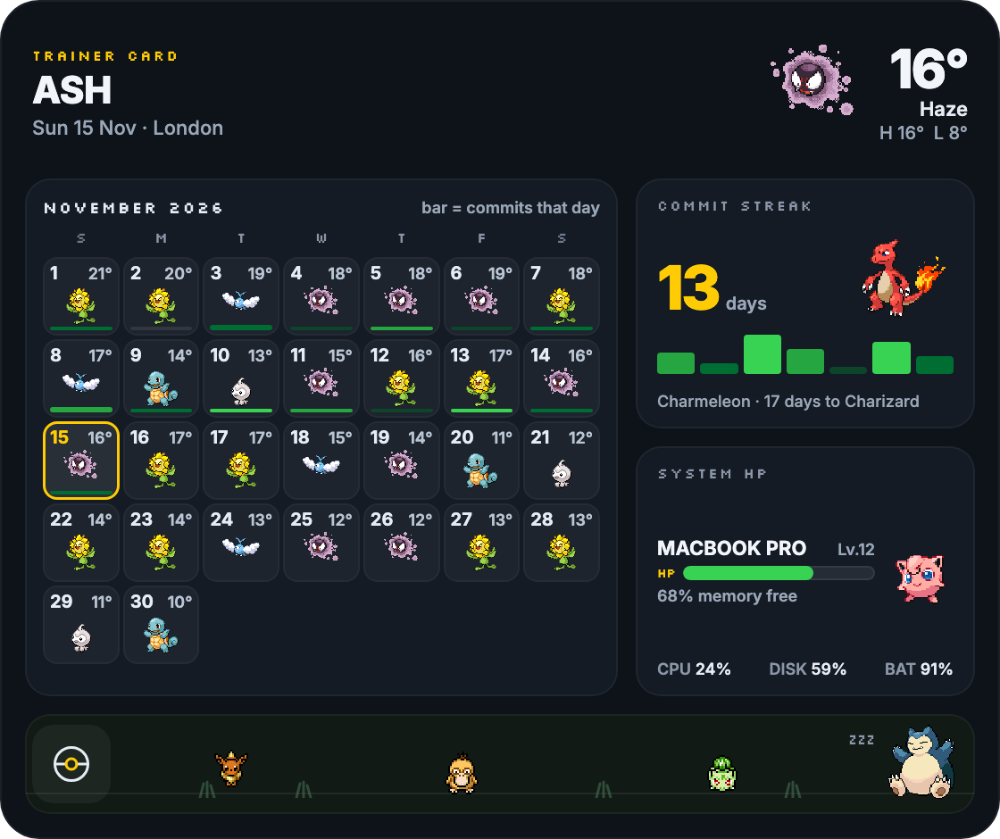
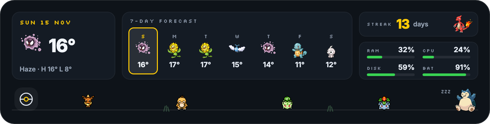
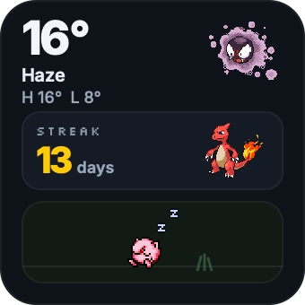
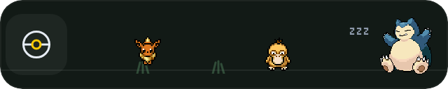

# Pokémon Desktop Widget

A little Pokémon-themed "trainer card" that lives on your Mac desktop. It shows the weather, a month calendar, your GitHub commit streak and your Mac's vitals, while pixel Pokémon wander along a grassy route at the bottom. Every now and then a **shiny** shows up. ✨

A hobby project: a native macOS app (Swift + WebKit) that pins a transparent window to the desktop layer, behind your other windows, so it feels like a widget but can animate smoothly.



## Sizes

Switch between four sizes from the menu bar icon (**◎ → Size**).

| Medium (748 × 190) |
|---|
|  |

| Small (170 × 170) | Mini route (320 × 64) |
|---|---|
|  |  |

## Features

- **Weather as Pokémon.** Live weather from [Open-Meteo](https://open-meteo.com) (free, no API key). Each condition has its own Pokémon: Sunflora for sunny, Swablu for part cloud, Castform for overcast, Gastly for haze, Squirtle for rain, Pikachu for storms, Snorunt for snow, Pidgey for wind.
- **Month calendar.** Past days show the weather that actually happened, upcoming days show the forecast (up to 14 days ahead). Click a day for details.
- **Commit streak that evolves.** Reads your GitHub contribution calendar through the GitHub CLI. Your streak evolves Charmander → Charmeleon (7 days) → Charizard (30 days). The green bar under each day is that day's contributions.
- **System HP.** Free memory as an HP bar (Jigglypuff, Psyduck or Gastly depending on how it's doing), plus CPU, disk and battery.
- **Walking Pokémon.** Real 8-direction walk cycles: they wander, turn around and pause. Click the Poké Ball to shuffle in new ones from all 386 Gen 1–3 Pokémon. Snorlax naps on the right.
- **Shinies.** Every Pokémon that arrives has a 1-in-64 chance of being shiny (configurable). Visitors rotate every few minutes, shinies arrive with sparkles, and the menu keeps a log of every shiny you've spotted.

## Requirements

- macOS 14 (Sonoma) or later
- Xcode or the Xcode Command Line Tools (`xcode-select --install`)
- Optional: the [GitHub CLI](https://cli.github.com) (`gh`), signed in, for the commit streak

## Setup

### 1. Get the code

```bash
git clone https://github.com/Maham-Anwaar/pokemon-desktop-widget.git
cd pokemon-desktop-widget
```

### 2. Download the sprites

Sprites aren't included in this repo (they're Nintendo's artwork). This script downloads them for Gen 1–3 (#1–386) into `~/Documents/Pokemon Widget/sprites` (about 45 MB):

```bash
./fetch_sprites.sh
```

It's safe to run again: it skips files you already have.

### 3. Build and install

```bash
./build.sh
```

This compiles the app and installs it to `/Applications/Pokemon Widget.app`. If you have an Apple Development certificate in your keychain, it's used for signing (macOS may ask once for your keychain password: choose **Always Allow**); otherwise the app is signed locally.

### 4. Open it

```bash
open /Applications/"Pokemon Widget.app"
```

The first time, macOS asks whether the app can access your **Documents** folder: click **Allow** (that's where the sprites and settings live).

The widget appears in the top-right corner of your desktop and a **◎** icon appears in the menu bar.

### 5. Optional: commit streak

The streak and green bars come from your GitHub contribution calendar. Install the GitHub CLI and sign in once:

```bash
brew install gh
```

```bash
gh auth login
```

Then choose **◎ → Refresh**.

## Using it

- **Move it:** drag from anywhere except the buttons. It remembers its position.
- **Menu bar (◎):** Shuffle Pokémon, Summon a shiny, Refresh, Shinies spotted, Size, Keep on desktop (turn off to float above windows), Open at login, Reset position, Edit settings, Open sprites folder, Quit.

## Settings

Settings live in `~/Documents/Pokemon Widget/config.json` (created on first launch). Edit it with **◎ → Edit settings…**, then choose **◎ → Refresh**.

```json
{
  "name": "ASH",
  "city": "London",
  "latitude": 51.5072,
  "longitude": -0.1276,
  "accent": "#FFCB05",
  "size": "large",
  "shinyOdds": 64,
  "keepOnDesktop": true,
  "useGitHub": true
}
```

| Key | What it does |
|---|---|
| `name` | Shown on the trainer card. Defaults to your macOS first name. |
| `city`, `latitude`, `longitude` | Where the weather comes from. Find coordinates on [latlong.net](https://www.latlong.net) or Google Maps. |
| `accent` | Highlight color. Try `#3B4CCA`, `#E3350D` or `#55D6A0`. |
| `size` | `large`, `medium`, `small` or `mini`. |
| `shinyOdds` | 1 in N arrivals is shiny. `4096` is real-game rarity. |
| `keepOnDesktop` | `true` pins it behind your windows, `false` floats it above them. |
| `useGitHub` | Set to `false` to skip the GitHub streak. |

Your shiny log is saved to `~/Documents/Pokemon Widget/shinies.json`.

## Project layout

| File | What it is |
|---|---|
| `main.swift` | The app: desktop-level window, menu bar, weather, GitHub contributions, system vitals, walk-sheet parsing |
| `widget.html` | The widget UI (all four sizes) and the walking/shiny animation |
| `build.sh` | Compiles, signs and installs the app |
| `fetch_sprites.sh` | Downloads the sprites |

## Uninstall

Quit from **◎ → Quit**, then:

```bash
rm -rf /Applications/"Pokemon Widget.app" ~/Documents/"Pokemon Widget"
```

## Troubleshooting

- **No sprites, empty boxes:** run `./fetch_sprites.sh`, and make sure the app was allowed to access Documents (System Settings → Privacy & Security → Files and Folders).
- **Streak says "GitHub contributions unavailable":** run `gh auth status`. If you're not signed in, run `gh auth login`.
- **Weather says "Offline":** check your internet connection; it retries every 30 minutes, or use **◎ → Refresh**.
- **Lost the widget off-screen:** **◎ → Reset position**.

## Credits

- Animated Black/White sprites from the [PokeAPI sprites](https://github.com/PokeAPI/sprites) repository.
- Walk-cycle sprite sheets from [PMDCollab SpriteCollab](https://github.com/PMDCollab/SpriteCollab) (CC BY-NC 4.0, by its many contributing artists).
- Weather data by [Open-Meteo](https://open-meteo.com) (CC BY 4.0).
- Fonts: [Inter](https://rsms.me/inter/) and [Silkscreen](https://fonts.google.com/specimen/Silkscreen) via Google Fonts.

Pokémon and all related names and artwork are © Nintendo, Creatures Inc. and GAME FREAK Inc. This is an unofficial, non-commercial fan project and isn't affiliated with or endorsed by them. No sprites are distributed in this repository.

## License

The code is under the [MIT License](LICENSE). It doesn't cover the sprites or any Pokémon artwork.
